<div align="center">

<a href="https://garrickz2.github.io/grove/">
  <picture>
    <source media="(prefers-color-scheme: dark)" srcset="docs/images/readme-hero-dark.jpg">
    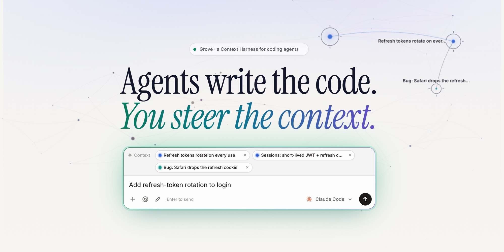
  </picture>
</a>

### Grove is a Context Harness for every coding agent.

Ten agents can work in parallel, each in its own worktree. You steer them by capturing, organizing and injecting the context they work from.

[](https://garrickz2.github.io/grove/)
[](https://crates.io/crates/grove-rs)
[](https://crates.io/crates/grove-rs)
[](LICENSE)
[](#requirements)

[**Website**](https://garrickz2.github.io/grove/) · [**Quick start**](#quick-start) · [**Install**](#install) · [**Capabilities**](docs/capabilities.md) · [**Plugin guide**](docs/plugin-development.md)

</div>

---

## The idea

You no longer write the final artifact. The agents do. Your job is to manage what they know.

ACP standardized how software talks to AI. Grove is the layer above it: it replaces the client with **context**, so the triad becomes **human ⇄ context ⇄ agent**. Every feature in Grove is one move on that context.

| Move | What it means | Where it lives in Grove |
|---|---|---|
| **Capture** | Outside context comes in, brought by you or fetched by the agent. | Studio and Shared Assets, sketches, web search, Figma and any MCP fetch |
| **Organize** | Notes are curated into memory that lasts and gets reused. | Project Memory: agents leave notes, an organizer merges them into linked memories |
| **Inject** | Context reaches the agent. You push it, or the agent pulls it. | The composer (files, sketches, memories), Agent context, Grove's MCP tools |
| **Negotiate** | Review comments, surveys and permission requests settle the result. | Code Review, the Dashboard's *Needs you* list, commit → rebase → merge → archive |

Running ten agents at once is how you lay the work out. Shipping fast is what you get when you feed them good context.

---

## A tour

Screenshots below come from a demo project and switch with your GitHub light or dark theme. Two of them, the Agent Graph and Buddy, are illustrations from the [website](https://garrickz2.github.io/grove/), because they need live agent sessions.

### Dashboard: what needs you

Start each day here. **Needs you** lists the permission requests and surveys agents are waiting on, and you can answer them inline. **In flight** shows every task with its branch and diff. **Agent context** shows exactly what each new session starts with: workspace instructions, Memory, MCP servers and skills, with their share of the token budget.

<picture>
  <source media="(prefers-color-scheme: dark)" srcset="docs/shots/dashboard-dark.jpg">
  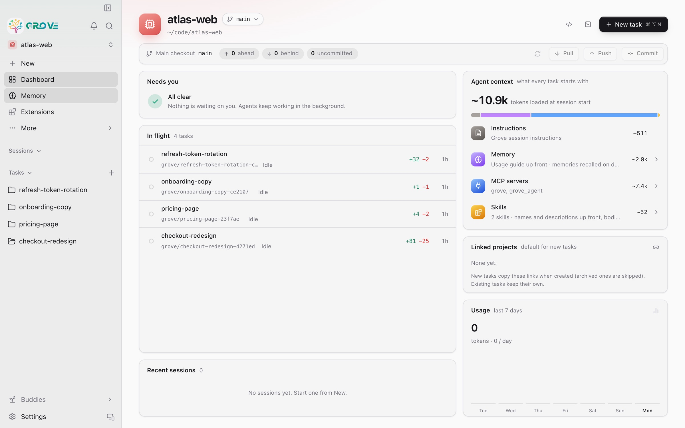
</picture>

### Every coding agent, in parallel

Ten agents are built in: Claude Code, Codex, Gemini CLI, GitHub Copilot, Cursor, Junie, Trae, Kimi, Qwen and OpenCode. Hermes, Kiro and OpenClaw are ACP-ready, and anything that speaks ACP over stdio or HTTP plugs in with one entry. Each task gets its own git worktree and terminal session, so agents don't collide. **Custom Agents** are reusable personas: a base agent, a system prompt and an effort level.

When agents need each other, they delegate through the **[Agent Graph](https://garrickz2.github.io/grove/#results)**. A planner spawns a coder, the coder spawns a reviewer, and replies route back as typed `<grove-meta>` messages, not strings glued through prompts. Cycles are caught at spawn and only one message is in flight per edge. The graph is exposed as MCP tools, so an orchestrator agent can drive it in code.

<picture>
  <source media="(prefers-color-scheme: dark)" srcset="docs/shots/graph-dark.jpg">
  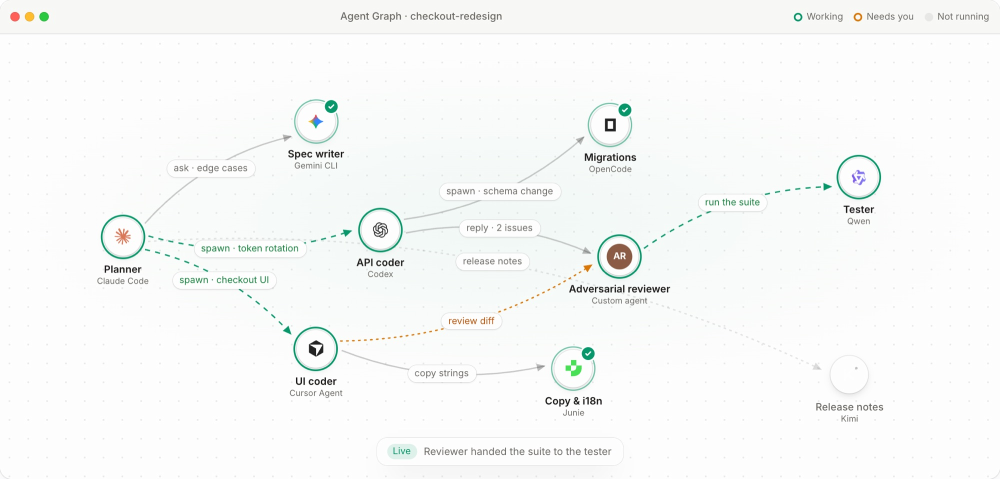
</picture>
<p align="center"><sub>Illustration of an Agent Graph mid-run.</sub></p>

### Project Memory: context that compounds

Chat history records what happened. Memory keeps what should matter next. Agents leave short notes as they work: decisions, corrections, lessons, each tied to the task and chat it came from. On a schedule, or early once enough notes pile up, an organizer agent merges them into durable memories that are titled, tagged and linked. New sessions search Memory before they start, and the composer shows exactly which memories were read this turn.

<picture>
  <source media="(prefers-color-scheme: dark)" srcset="docs/shots/memory-dark.jpg">
  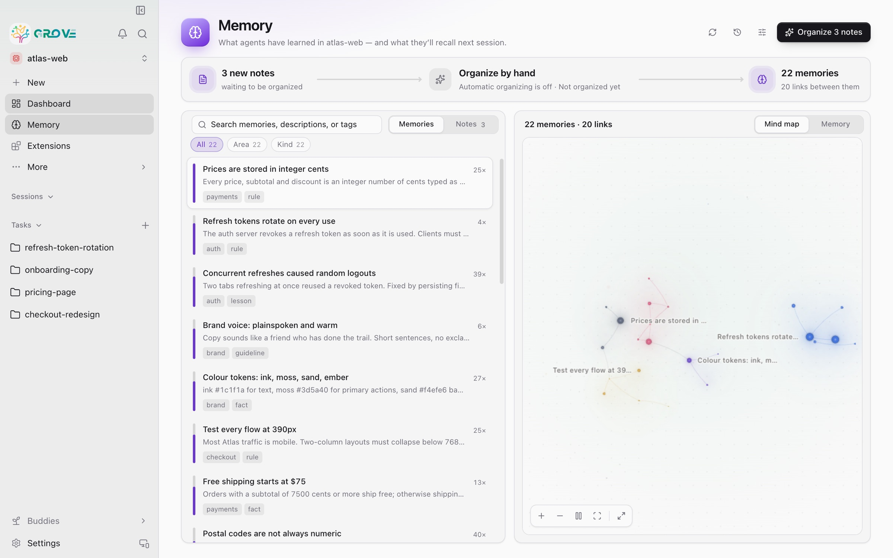
</picture>

Expand the mind map and the same memories become a sky you can turn, zoom and pin.

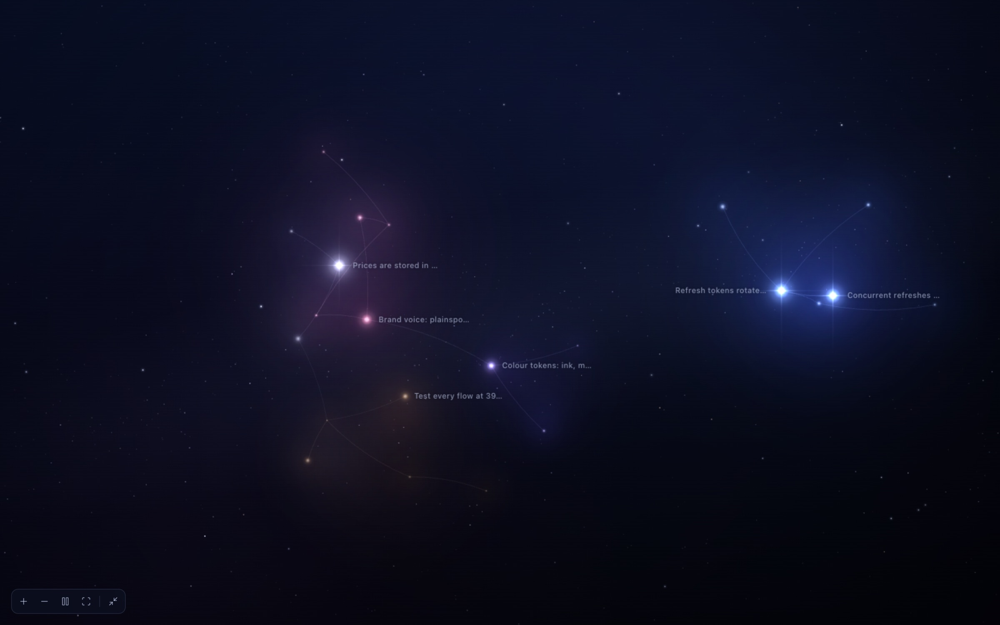

### Buddy: a teammate that stays on

A Buddy is a long-lived assistant with a name, a role and its own Memory, in one continuous conversation. It does small things itself and hands session-sized work to task agents, then follows that work back to you. It runs routines on a schedule, and you can bind it to Feishu, Lark or WeChat to talk to it from there.

<p align="center">
  <picture>
    <source media="(prefers-color-scheme: dark)" srcset="docs/shots/buddy-dark.jpg">
    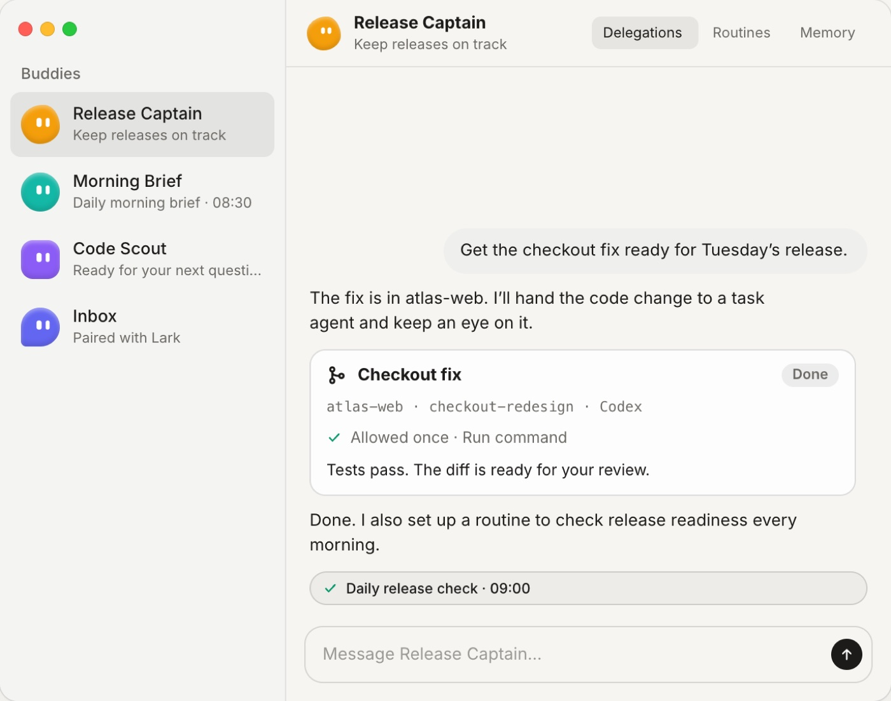
  </picture>
  <br><sub>Illustration of a Buddy delegating a fix and setting up a routine.</sub>
</p>

### Studio: for the work that isn't code

Studio is a project type for briefs, brand guides, specs and layouts, with no git worktree. Sketches are Excalidraw canvases with checkpoints that agents can read and build against. **Shared Assets** are hard-linked into every dependent task, so each agent reads the same files, and **Instructions** tell every agent how to work here.

<picture>
  <source media="(prefers-color-scheme: dark)" srcset="docs/shots/studio-dark.jpg">
  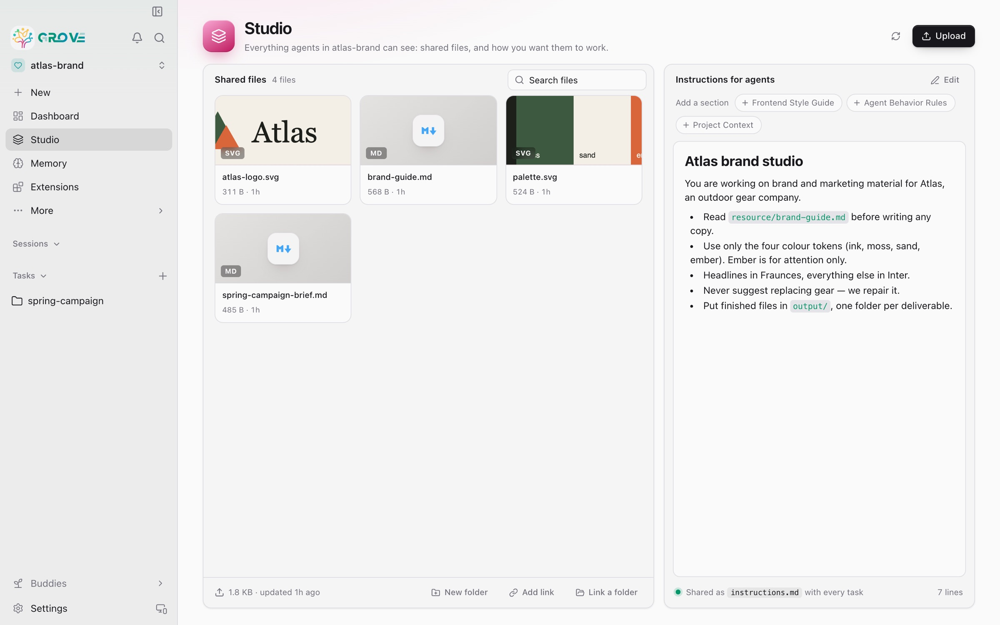
</picture>

### Code Review: settle the work in context

Line-level threaded comments on each task's diff, resolvable by you or the agent. Select a batch of comments and send them to the agent: one diff addresses all of them, and you approve that diff instead of each comment. Commit, rebase, merge and archive follow in one step, with squash-merge detection.

<picture>
  <source media="(prefers-color-scheme: dark)" srcset="docs/shots/review-dark.jpg">
  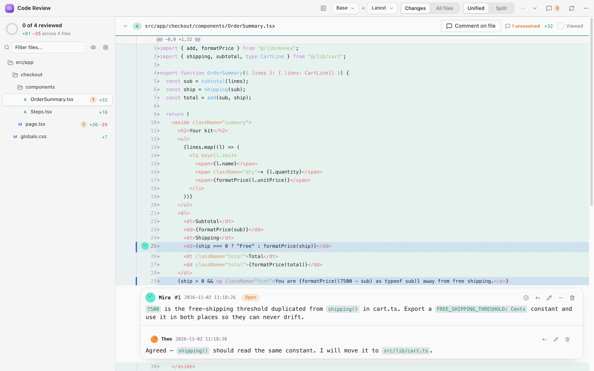
</picture>

### Extensions and plugins

Install skills and MCP servers once, then choose which agents get them, per project or globally. **Plugins** open the policy layer: a plugin is a folder with a `plugin.json`, built against a typed SDK. It can add a panel or sidebar page, an MCP server, skills, or a backend that subscribes to Grove events. See the [plugin guide](docs/plugin-development.md).

<picture>
  <source media="(prefers-color-scheme: dark)" srcset="docs/shots/extensions-dark.jpg">
  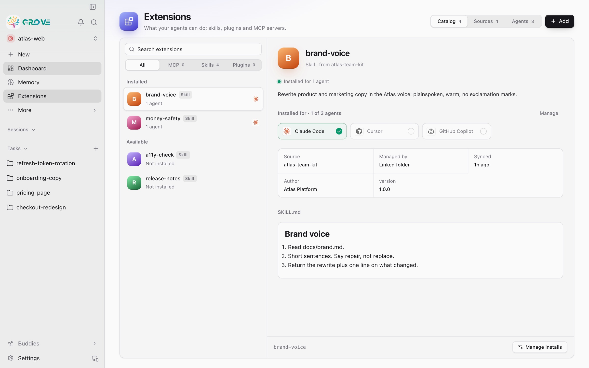
</picture>

### Five surfaces, one binary

The same tasks, agents and worktrees everywhere:

- **Web** (`grove web`): the main surface, with FlexLayout panels, an IDE Layout mode and a ⌘K palette.
- **GUI** (`grove gui`): the same app in a native Tauri window, with a system tray and OS notifications.
- **TUI** (`grove tui`): the original keyboard-first surface, with the full review workflow.
- **Mobile** (`grove mobile`): scan a QR code from your phone; every request is HMAC-SHA256 signed.
- **Radio**: hold to talk from your phone. Nine channels, each bound to a task's chat or terminal.

<picture>
  <source media="(prefers-color-scheme: dark)" srcset="docs/shots/web-dark.jpg">
  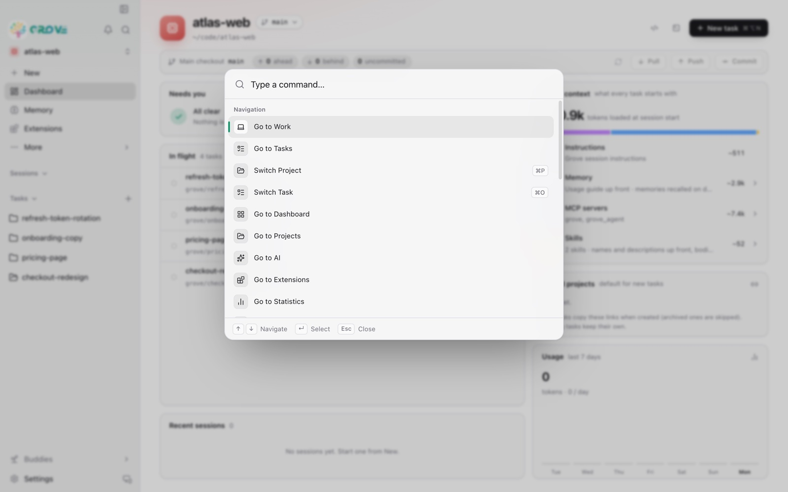
</picture>

<picture>
  <source media="(prefers-color-scheme: dark)" srcset="docs/shots/tui-dark.png">
  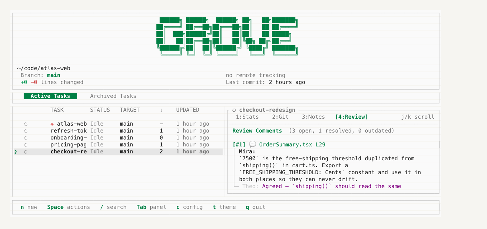
</picture>

<p align="center">
  <picture>
    <source media="(prefers-color-scheme: dark)" srcset="docs/shots/mobile-dark.jpg">
    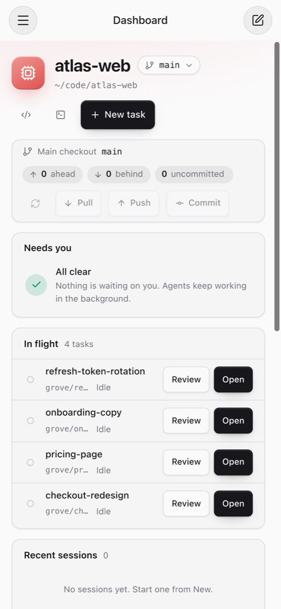
  </picture>
  &nbsp;&nbsp;
  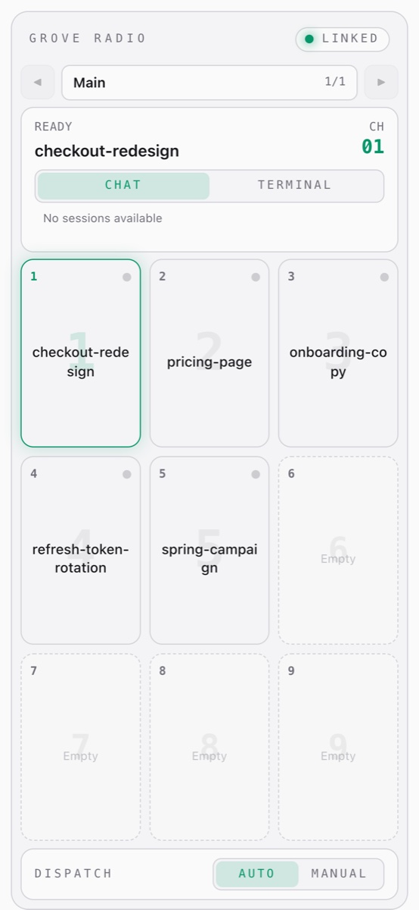
</p>

---

## Quick start

Let your AI agent install Grove (see [Install](#install) below). Or, if you insist:

```bash
brew tap GarrickZ2/grove && brew install grove   # macOS — Install covers Linux, Windows, Cargo
```

Then, inside any directory:

```bash
grove        # resumes your last surface
grove web    # browser IDE at http://localhost:3001
grove gui    # native desktop window
grove tui    # terminal UI
```

---

## Install

Single binary. Web IDE embedded. Requires Git and a terminal multiplexer (tmux or Zellij) on Unix.

### For humans

Don't read install docs. Paste this into your AI agent (Claude Code, Cursor, Codex CLI, AmpCode — any of them):

> Install and configure Grove by following the instructions here:
> https://raw.githubusercontent.com/GarrickZ2/grove/master/docs/install.md

The agent handles the Homebrew tap, the shell installer, PATH wiring, and platform-specific quirks.

If you prefer to type a command yourself:

```bash
# Homebrew (macOS)
brew tap GarrickZ2/grove && brew install grove

# Shell installer (macOS / Linux / WSL)
curl -sSL https://raw.githubusercontent.com/GarrickZ2/grove/master/install.sh | sh

# Shell installer — Linux with GUI (x86_64)
curl -sSL https://raw.githubusercontent.com/GarrickZ2/grove/master/install.sh | GROVE_GUI=1 sh

# PowerShell (Windows)
irm https://raw.githubusercontent.com/GarrickZ2/grove/master/install.ps1 | iex

# Cargo
cargo install grove-rs                 # TUI + Web + MCP
cargo install grove-rs --features gui  # + native desktop GUI
```

**Prebuilt binaries** (`.dmg` / `.exe` / `.AppImage` / `.tar.gz`): [latest release](https://github.com/GarrickZ2/grove/releases/latest).

> **macOS tip** — if the `.dmg` won't open ("Grove is damaged"), it's Gatekeeper quarantine on an unsigned build:
> ```bash
> xattr -rd com.apple.quarantine /Applications/Grove.app
> ```

### For agents

LLM agent reading this README and asked to install Grove — fetch the canonical install guide and follow it:

```bash
curl -s https://raw.githubusercontent.com/GarrickZ2/grove/master/docs/install.md
```

The guide covers OS detection, package-manager choice, PATH setup, and post-install verification. State lives under `~/.grove/` (config, tasks, AI artifacts, notes, SQLite) — never edit by hand.

---

## Requirements

- Git 2.20+
- tmux 3.0+ or Zellij *(not required on Windows)*
- macOS 12+, Linux, or Windows 10/11

**Linux GUI runtime deps** (Debian/Ubuntu):

```bash
sudo apt install libwebkit2gtk-4.1-0 libgtk-3-0 libayatana-appindicator3-1 librsvg2-2
```

---

## Learn more

| | |
|---|---|
| 🌿 **[Website →](https://garrickz2.github.io/grove/)**<br>The harness, shown hands-on. | 📜 **[Capabilities →](docs/capabilities.md)**<br>Full feature reference. |
| 🧩 **[Plugin guide →](docs/plugin-development.md)**<br>Panels, MCP servers, skills, backends. | 📦 **[Install guide →](docs/install.md)**<br>Detailed setup, for you or your agent. |

---

## License

MIT
